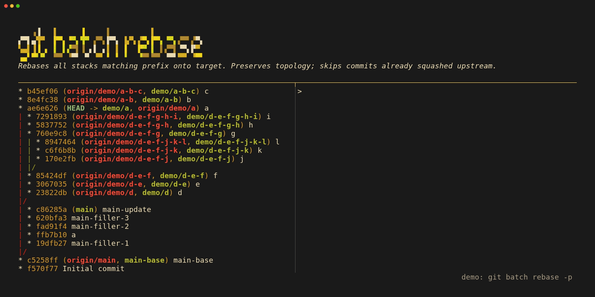
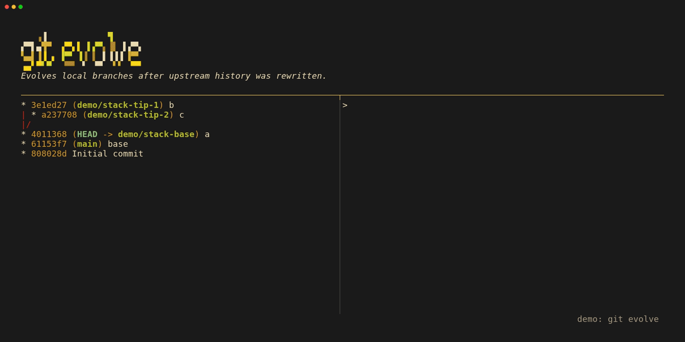
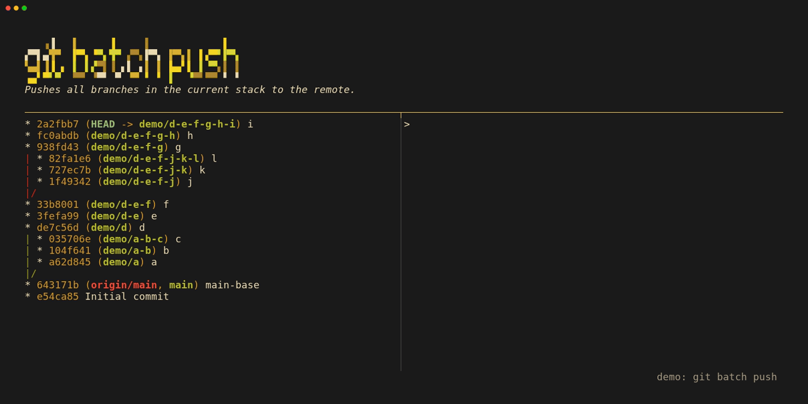
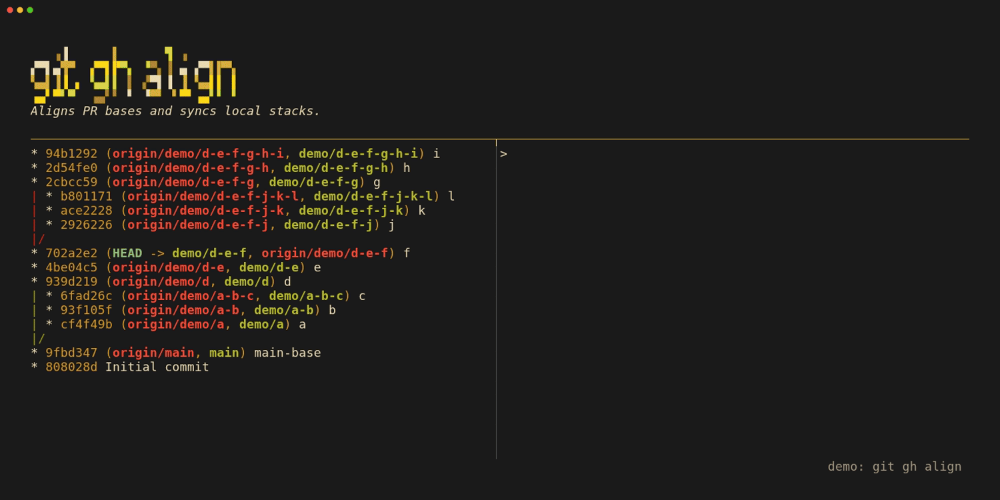
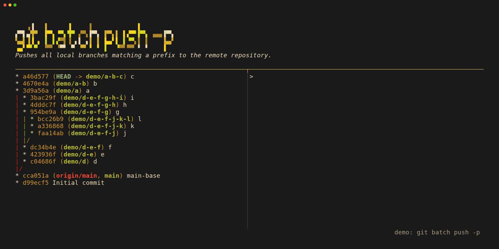
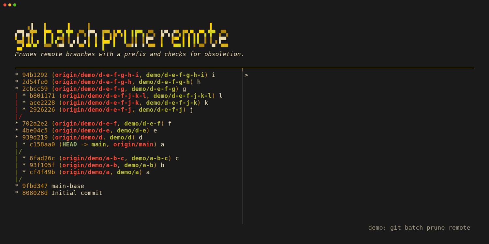
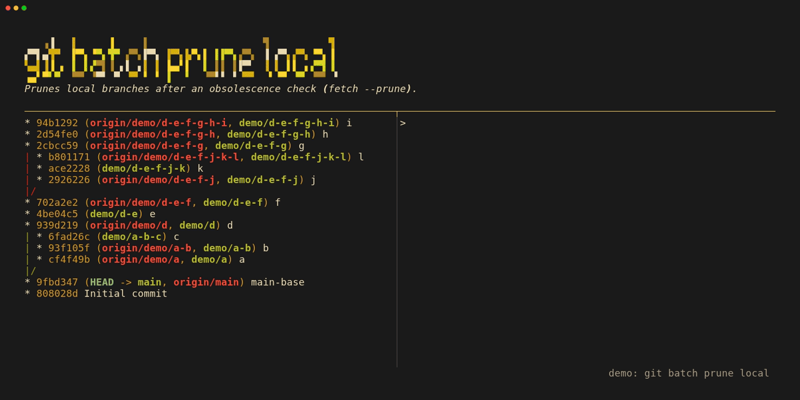

# Git Stack Utilities

[](https://github.com/methylDragon/git-scripts/actions/workflows/main.yml)
[](https://coveralls.io/github/methylDragon/git-scripts?branch=main)

A collection of scripts to wrangle branches, especially in a [stacked-diff](https://newsletter.pragmaticengineer.com/p/stacked-diffs) context in repos where the main branch keeps updating.

These scripts handle "obsolete" commits, merged commits, and branching histories relatively intelligently. Stack structure and branching are preserved, and any rebase issues are flagged and gracefully aborted for that stack.

## Demos

These tools are designed to streamline the workflow of managing [Stacked Pull Requests](https://newsletter.pragmaticengineer.com/p/stacked-diffs).

We'll showcase its usefulness with a typical workflow of trying to create a stack for GitHub.

We'll:

1. **Pull and rebase:** Pull the latest changes and rebase our stacks using `git batch rebase` (current stack) or `git batch rebase --prefix <pfx>`.
1. **Evolve:** Rewire any orphaned stacks we generate if we ever need to amend using `git evolve`.
1. **Push:** Mass push branches in the stack using `git batch push` (current stack) or `git batch push --prefix <pfx>`.
1. **Sync:** Now that the branches are on GitHub, automatically create PRs and align GitHub stacks using `git gh align` to match our stack topology.

### `git batch rebase --prefix <pfx>`



### `git evolve`



### `git batch push`



### `git gh align`



We also have other functionalities for mass pushing beyond stacks, and cleaning up the local and remote repos!

<details>
<summary><b>View More Demos</b></summary>

### `git batch push --prefix <pfx>`



### `git batch prune remote --prefix <pfx>`



### `git batch prune local`



</details>

## Setup

1. **Install:** Run the automated installer, which clones the repo. *(It will automatically install [`pixi`](https://pixi.sh/) if you don't already have it.)*

   ```bash
   curl -sSL https://raw.githubusercontent.com/methylDragon/git-scripts/main/install.sh | bash
   ```

   **Note: Local Installation**

   If you have a local clone of this repository and want to install from it (useful for development), you can run this instead:

   ```bash
   ./install.sh --local
   ```

This sets up the environment and creates symlinks to `~/.local/bin` directly from your local clone.

1. **Verify:** Ensure `~/.local/bin` is in your system's `$PATH`.

The installer creates native Git subcommands! Because the executables are prefixed with `git-` and placed in your `PATH`, Git automatically recognizes them.

To update the scripts later, simply run:

```bash
git-scripts-update
```

## Usage

You can invoke these scripts just like native Git commands:

### Standard Git Utilities

Running any parent command (`git batch`, `git gh`, or `git gk`) without arguments displays its available subcommands.

| Command                                                                                                    | Description                                                                                                                                                                                                                                                                                                                                                                                                                                                                                                      |
| :--------------------------------------------------------------------------------------------------------- | :--------------------------------------------------------------------------------------------------------------------------------------------------------------------------------------------------------------------------------------------------------------------------------------------------------------------------------------------------------------------------------------------------------------------------------------------------------------------------------------------------------------- |
| **`git batch rebase [target] [--current\|-c] [-p/--prefix <pfx>] [--all-worktrees] [--auto-delete] [-n]`** | **Stack / Prefix Rebase.** Rebases the current linear stack (default, or `--current`) or all branch stacks matching `--prefix <pfx>` onto `target` (default: `main`). Preserves topology; skips commits already squashed upstream.                                                                                                                                                                                                                                                                               |
| **`git batch push [--current\|-c] [-p/--prefix <pfx>] [--target <branch>] [-n] [opts]`**                   | **Stack / Prefix Push.** Pushes all out-of-sync branches in the current linear stack (default, or `--current`) or all local branches matching `--prefix <pfx>` to `origin`. Forwards extra args (e.g., `--force-with-lease`) to `git push`.                                                                                                                                                                                                                                                                      |
| **`git batch prune local [target] [-p/--prefix <pfx>] [-n/--dry-run] [--also-prune-no-upstream]`**         | **Local Cleanup.** Deletes local branches whose remote tracking branches are gone (optionally scoped to `--prefix`). Use `--also-prune-no-upstream` to also prune branches lacking upstream tracking (checking obsolescence against `target`, default: `main`).                                                                                                                                                                                                                                                  |
| **`git batch prune remote [target] -p/--prefix <pfx> [-n/--dry-run] [--also-prune-no-local]`**             | **Remote Cleanup.** Deletes remote `origin/<pfx>*` branches that are fully merged or squash-merged into `target` (default: `main`). Use `--also-prune-no-local` to also inspect remote branches lacking a local counterpart.                                                                                                                                                                                                                                                                                     |
| **`git evolve [old_hash]`**                                                                                | **Rescue Orphans.** Run immediately after `git commit --amend` to rebase child branches onto the new HEAD automatically. Calculates from reflog if `old_hash` is omitted.                                                                                                                                                                                                                                                                                                                                        |
| **`git gk <install/verify/uninstall> [repo] [--config] [--keep-recent-tags]`**                             | **GitKraken Worktree Optimizer.** Improves GitKraken performance on large repositories and linked worktrees by pruning file-watcher directory traversal, making cached tab switches non-blocking, disabling commit detail panel transition lag in memory, retaining a rolling window of CI tags and remote release branches, enabling commit-graph and untracked-cache acceleration, and auto-refreshing linked worktrees. See [`src/git_scripts/gk/optimize/README.md`](src/git_scripts/gk/optimize/README.md). |

> **Note:** All commands support `--plain` (disables rich UI formatting) and `-y/--yes` (bypasses confirmation prompts).

### GitHub Utilities

These commands are strictly for GitHub repositories and require the [GitHub CLI (`gh`)](https://cli.github.com/) to be installed and authenticated (`gh auth login`).
**Recommended:** Install the [github/gh-stack](https://github.com/github/gh-stack) extension (`gh extension install github/gh-stack`) to automatically link PRs into stack tables of contents!

| Command                                                                                 | Description                                                                                                                                                                                                                                                                                                                        |
| :-------------------------------------------------------------------------------------- | :--------------------------------------------------------------------------------------------------------------------------------------------------------------------------------------------------------------------------------------------------------------------------------------------------------------------------------- |
| **`git gh align [target] [--current\|-c] [-p/--prefix <pfx>] [--all\|-i] [-r <name>]`** | **GitHub PR Sync.** Modifies the base branch of GitHub Pull Requests to match your local topological history, prompts to push out-of-sync local branches or create missing PRs (populating repo PR templates automatically), and synchronizes `gh stack` links. Defaults to syncing the current branch's linear stack up to trunk. |

### Working with Worktrees

If you heavily utilize `git worktree` for stacked PRs, you might run into Git lock errors when trying to update a branch that is currently checked out in another worktree.

The `git batch rebase` command accepts an `--all-worktrees` flag, while `git evolve` handles worktrees **automatically**. When active, the tool detects if any branches in your stack are checked out in other worktrees. It safely detaches those worktrees, performs the complex topology rebases, and then cleanly re-checks out the updated branches in their original worktrees.

If you use **GitKraken Desktop** on Linux with linked worktrees, run `git gk install <repo>` (see [`src/git_scripts/gk/optimize/README.md`](src/git_scripts/gk/optimize/README.md)) to prevent GitKraken's file watcher from following child symlinks or indexing generated directories, eliminate `"Opening repo"` stalls on cached tab switches and commit detail panel slide-in lag, maintain a bounded rolling window for CI tags and remote release branches, shrink bloated `repoSettings` files, and automatically refresh the commit graph after terminal Git commands.

## Testing

This repository uses `pytest` for unit testing the Python logic and `absltest` for parameterization. We also use `pytest-xdist` to speed up tests by running them in parallel.

1. **Install dependencies:**
   `pixi install` will automatically handle all required dependencies.

1. **Run tests:**

   ```bash
   pixi run test
   ```

## Development

If you'd like to contribute to this project, we enforce formatting (`ruff-format`) and linting (`ruff`) for Python files, as well as `markdownlint` and shell linting/formatting via `prek`.

1. **Install dependencies and hooks:**
   Everything is managed via `pixi`. Remember to run `pixi install` if you cloned this repository.

   ```bash
   pixi run setup
   ```

   Now, every time you commit, it will automatically check your scripts.

1. **Run manually:**
   You can trigger formatting and linting across all files without committing by running:

   ```bash
   pixi run lint
   ```
